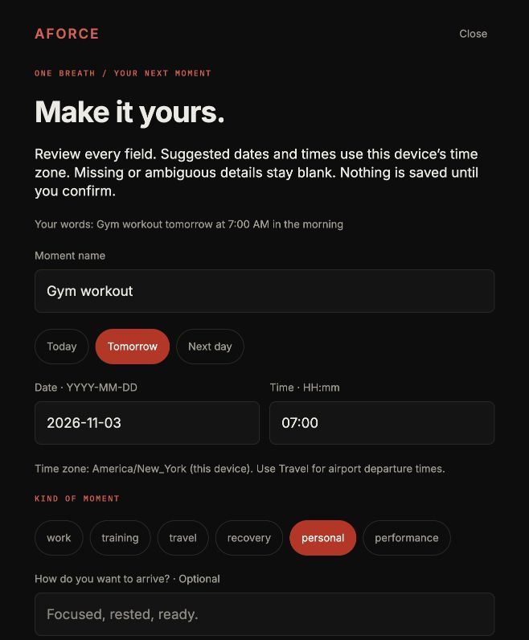
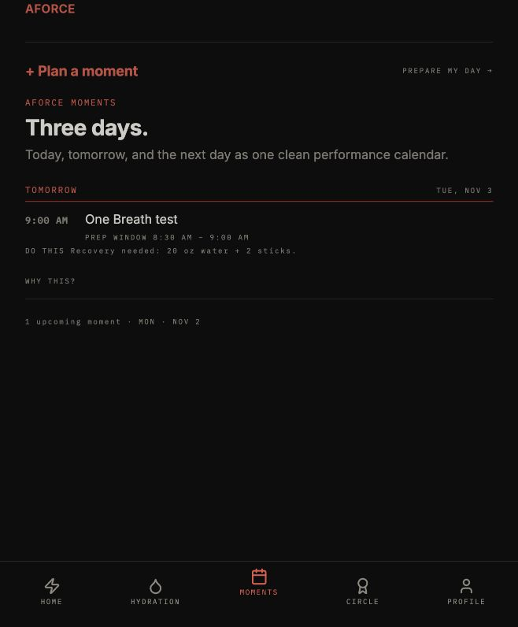

# One Breath polish — internal follow-up

Owner approved 2026-11-02 after testing build134: cleaner suggested titles, preparation guidance once in the Moments list, and edge-case verification.

New drafts separate recognized, unambiguous local schedule phrases from the suggested name: "Gym workout tomorrow at 7:00 AM in the morning" becomes "Gym workout" and "Meeting tomorrow morning at 8 AM with Julius" becomes "Meeting with Julius". Original words remain visible on review; every field remains editable. Ambiguous/negated input, unsupported time zones, and flights are not silently interpreted. No existing saved title or record is migrated.

Inside the existing internal Moments-first gate, the list shows the canonical instruction once beside the next unfinished upcoming Moment. Other rows retain their title, clock, preparation window, and detail link. Completed rows retain DONE. Accessibility follows the same composition and avoids dangling "Do this" announcements on quiet rows. The public composition remains unchanged. Recommendation text, score calculations, preparation timing, and persistence are unchanged.

198 tests passed across 20 focused suites; mobile TypeScript passed. New coverage renders four real row components and checks one visible/spoken instruction, quiet later rows, absent-command silence, priority advancement after old/prepared events, and the unchanged public branch. Capture tests cover denied permissions, pending-permission cancellation/account switches, interrupted recognition with retained partial text, late-result suppression, and retry after end. Confirmation tests cover editing, cancellation, ambiguity, and duplicate saving.

Browser runtime: exact reported gym wording produced the clean name plus date2026-11-03/time07:00 with original words visible. Cancelling left the existing count at one. Planner showed the existing command once instead of twice within its row. Four-row composition is covered by the render harness; the browser account is separate from iPhone storage. New native build acceptance remains a distinct gate.

