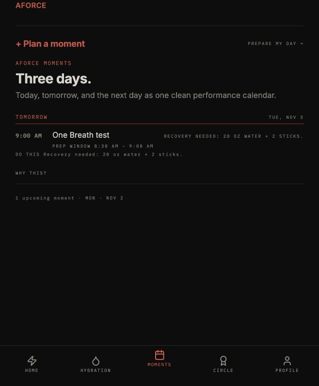

# One Breath — internal voice-to-Moment

Owner direction, 2026-11-02: continue the existing One Breath through build, verification, internal release, and one saved Moment. This extends the prior type-only scope; it does not alter hydration guidance or navigation.

The existing internal Moments-first gate now offers on-device English speech recognition on compatible iPhones. Capture begins only after Speak a moment and contextual microphone permission. No audio file is persisted; network recognition is prohibited by the native start options. Unsupported devices and web retain typing. Capture aborts on dismissal, backgrounding, or account changes and stops after 30 seconds.

Spoken words remain an editable draft. Local parsing offers only explicit AM/PM times and simple today/tomorrow/weekday/ISO-date suggestions. Missing, conflicting, timezone-qualified, and flight details require explicit review. Existing future-time/DST validation and the synchronous confirmation latch remain authoritative. Only Confirm plan calls the existing account-scoped Moments store.

The native dependency is pinned to Expo SDK 54's 3.1.3 release. A new runtimeVersion prevents an OTA bundle requiring the new module from reaching an older binary. Public One Breath remains its review-only surface; voice planning stays inside the existing internal build gate.

Local verification: mobile TypeScript passed. Capture lifecycle, permission cancellation, on-device-only options, no audio persistence, background/account cancellation, editable parsing, explicit confirmation, duplicate submission, public containment, and account-store isolation are covered by focused tests. Native audio and TestFlight installation require separate device evidence; automated mocks are not device proof.

Verified 2026-11-02: 191 tests across 19 focused suites passed, and mobile TypeScript passed. Browser runtime rejected missing time, showed a suggested November 3 09:00 schedule for "tomorrow at 9 AM", and saved exactly one clearly labeled "One Breath test". After reload it remained on Home and in Moments with "1 upcoming moment". This record is browser-local and does not prove a save on the iPhone. The preview's pre-existing onboarding redirect reappears on reload; choosing Sign In restored the same authenticated account and saved plan.

