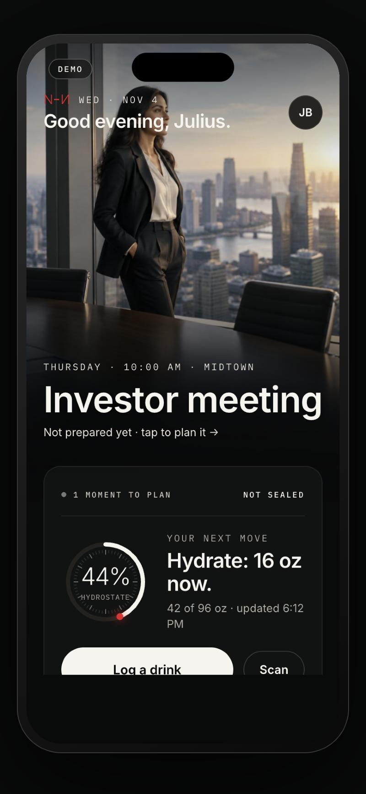
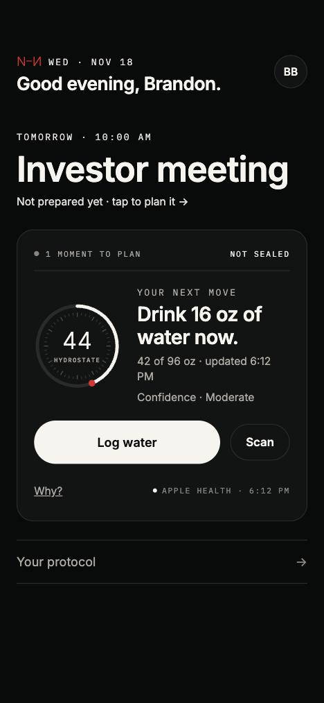
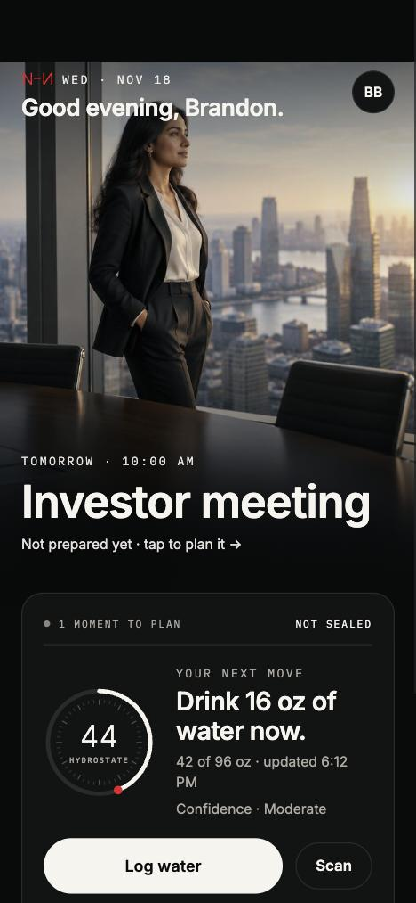
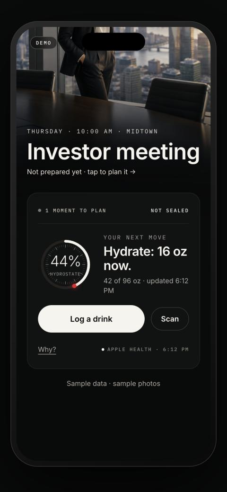
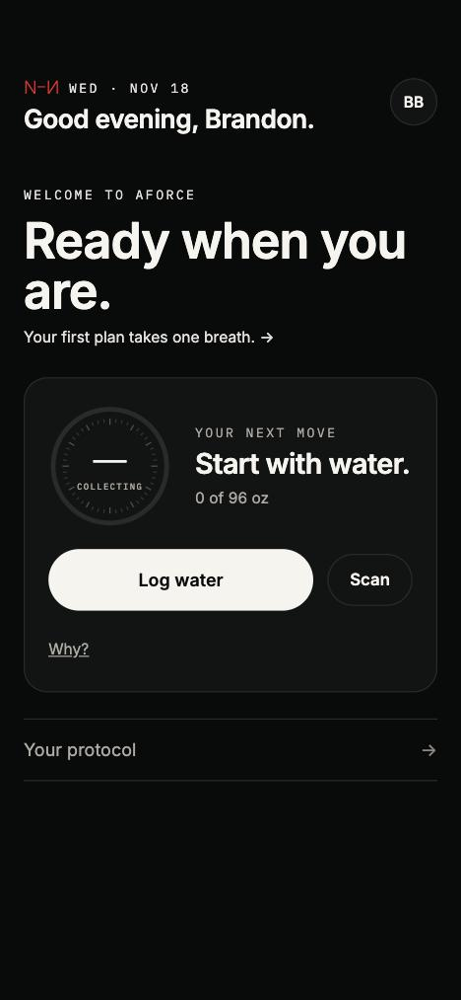

# AFORCE OS · Visual parity with the approved prototype

**Started:** 2026-11-18 · **Governing spec:** Complete App Spec v1.8.2 · **Visual reference:** "Every tab, one system." prototype (version `1794374401-aafd`)
**Acceptance standard:** a screen matches the prototype, except for documented functional, safety, accessibility or platform constraints. CI passing is not acceptance. Nothing here is accepted until it is seen on a physical device.

## 1. What build 165 actually contains

| | |
|---|---|
| iOS build 165 | EAS `2da3b5ad`, profile `internal-social`, commit **`85d8a708`**, clean tree |
| In build 165 | #1229 Profile entry on Home · #1231 tokens · #1232 mark component · #1233 bottom bar · #1234 warm-white buttons · #1237 Profile entry on other tabs |
| **Not** in 165 (in 166) | #1238 hidden empty Hydration rows · #1239 orb geometry · #1240 opening-screen mark · #1241 Circle header |
| In no build yet | The Home rebuild in this pull request |

Why 165 did not look like the prototype: those changes replaced colours, the mark, the bar and button fills. **No screen's layout was rebuilt.** Home was still the older "focused" layout (a red-railed One Breath card, a large state word and number, a signals footer, a button at the foot).

## 2. How reference and app images are captured

- **Reference:** the prototype is opened in a browser at phone width and photographed. These are real captures of the approved prototype.
- **App:** the real component is rendered in a browser harness at the same width with fixed example values. **This is not a device screenshot.** It shows layout, type, colour and spacing; it cannot show safe areas, the status bar, native fonts rendering, motion or touch.
- **Why not the simulator:** the app shows nothing until the sign-in service answers (a deliberate safety gate). I have no sign-in key on this machine and did not bypass the gate. With the development publishable key supplied locally by a founder, the app's own capture mode would give true simulator screenshots.
- **Device:** every screen still needs a physical-device check. None has been done for this work.

## 3. Home

| Reference | Rebuilt (what ships: no photograph) | Rebuilt with the prototype's sample photo (**not shipped**) |
|---|---|---|
|  |  |  |

Reference, lower half:  · Nothing planned: 

| Element | Reference | Rebuilt | Match |
|---|---|---|---|
| Mark + date, greeting, member photo top right | Yes | Yes; greeting follows the time of day and the member's real name | ✔ |
| Next Moment: when, name in 42pt, status with arrow | Yes | Yes, from the member's real next Moment | ✔ |
| Full-bleed World photograph, 540pt, fading to black | Yes | **No photograph.** The component supports it; no licensed World photography exists | ✘ asset |
| One panel, 20pt radius, hairline border | Yes | Yes | ✔ |
| Panel overlaps the photo and is translucent with blur | Yes | Overlap only when a photo is present; solid panel, no blur | ◐ |
| Status line ("1 Moment to plan · Not sealed") | Yes | Yes, counted from real Moments; hidden when nothing is planned | ✔ |
| HydroState ring, 104pt, ticks, warm-white arc, end dot | Shows intake as a percentage ("44%") | Shows the **HydroState score** ("44"); "Collecting" with no number when evidence is limited | ◐ decision H1 |
| "Your next move" + one line | "Hydrate: 16 oz now." (sample) | The scoring engine's real next move | ✔ |
| Intake and last update | "42 of 96 oz · updated 6:12 PM" | Same shape, real values | ✔ |
| Extra line under it | None | "Confidence · Moderate" kept beside the reading | ◐ safety (stop-ship SS-22) |
| Primary + ghost buttons | "Log a drink" · "Scan" | "**Log water**" · "Scan" | ◐ functional H2 |
| "Why?" link and data source | Yes | Yes; "Why?" shows the engine's reason in place | ✔ |
| Side gutter | 20pt | 20pt on Home (the rest of the app is 32pt) | ✔ decision H3 |
| Red callouts, state word, big number, signals footer, foot button | None | Removed from the internal Home | ✔ |
| Quiet list at the foot | Not shown | "Your protocol", and "Skin intelligence" behind its flag (Appendix G) | ✔ spec |
| "Sample data · sample photos" footer | Yes | Not shown: the app shows real data | n/a |
| Slow photo drift (Ken Burns), still under Reduce Motion | Yes | Not built (no photograph) | ✘ asset |

**Scope of the change.** Internal builds only (the "focused" Home that TestFlight testers see). The store-build Home layout is unchanged until this one is approved.

**Kept working:** water logging through the existing open-only picker, the offline banner, the last-known-delivery notice, the Travel card and Concierge entry behind their flags, the Social indicator, Profile entry.

## 4. Parity checklist — remaining screens

Reference captured means a real image of the prototype exists in this folder. "—" means not yet done.

| Screen / state | Reference captured | App captured | Compared | Corrected | Device |
|---|---|---|---|---|---|
| Home · Moment planned | ✔ | ✔ harness | ✔ | this PR | — |
| Home · nothing planned / new member | — | ✔ harness | — | this PR | — |
| Home · Social tonight | ✔ (seen, not saved) | — | — | — | — |
| Hydration · tab | — | — | — | — | — |
| Hydration · log sheet | — | — | — | — | — |
| Hydration · log result | — | — | — | — | — |
| One Breath · Capture | ✔ | — | — | — | — |
| One Breath · Mirror / Plan / Seal / Lock In / Quiet / Return / Replay | — | — | — | — | — |
| Moments · Now / Upcoming / Done | — | — | — | — | — |
| Circles · empty / with people / invite / pending / privacy | — | — | — | — | — |
| Profile | — | — | — | — | — |
| HydroScan · five steps | — | — | — | — | — |
| Opening / first launch | ✔ (seen, not saved) | — | — | — | — |

## 5. Missing assets register

| # | Asset | Needed for | Status |
|---|---|---|---|
| A1 | Licensed World photography (the prototype has about 116 photos; all are AI samples cleared for TestFlight and investor demos only) | Home hero, Moments cards, Circle cards, One Breath scenes | **Missing.** Register #20, founder decision D8 |
| A2 | The 19 "Activity only" scene assets | Solo Moments (Appendix D §8.1) | Missing |
| A3 | Approved N–И vector | The mark everywhere | Missing; the app uses the typed construction (D10) |
| A4 | Native splash image | App launch | Still the old heavy mark in bone with a red dash (seen in the simulator) |
| A5 | App icon | Home screen | Not inspected |
| A6 | Studio voice lines (46 audio files in the prototype) | One Breath read-backs | Not in the app; production voice undecided (#47) |
| A7 | Social v0.4.1 and HydroScan v2 sources | Circles/Social, HydroScan | Not in the repo (D16) |

## 6. Open design decisions raised by Home

| # | Decision | Recommendation |
|---|---|---|
| H1 | **What the Home ring shows.** The prototype's ring is intake ÷ target, labelled "HydroState". In the app HydroState is the 0–100 score. | Keep the score: it is what "HydroState" means everywhere else. Julius to confirm |
| H2 | **"Log a drink" vs "Log water".** The spec (register #40) wants "Log a drink" with a drink choice. Home's sheet logs water only. | Keep "Log water" until the drink-choice sheet is wired, then rename. Labelling a water-only sheet "Log a drink" would mislead |
| H3 | **Gutter.** Prototype 20pt; an earlier founder decision (D6) set 32pt. | Adopt 20pt screen by screen as each is rebuilt |
| H4 | **May internal TestFlight builds show the prototype's AI sample photos?** The spec clears them for TestFlight and investor demos. | Founders' call (D8). The Home hero is built to take a photo the moment this is answered |
| H5 | **Confidence line** beside the reading is not in the prototype. | Keep: stop-ship SS-22 depends on it |
