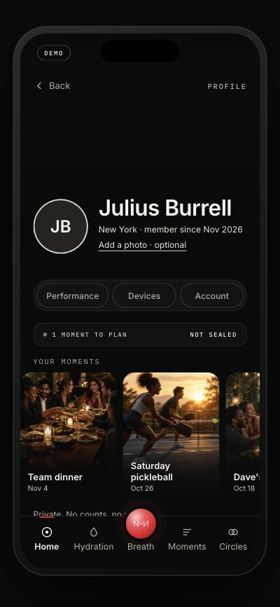
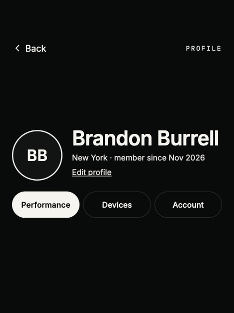

# Demo vs app — every tab

**Date:** 2026-11-18 · **Demo:** "Every tab, one system." (version `1794374401-aafd`) · **App:** `main` plus the two open pull requests named below.
**Rule (founder, 2026-11-18):** each screen must look like the demo, and anything not in the demo must not be there.

Read this as the list of what is left. "Seen on a phone" is **no** for every row unless stated; my images are browser renders of the real components.

Legend: ✔ matches · ◐ differs for a stated reason · ✘ missing.

## Bottom bar

| Demo | App | |
|---|---|---|
| Five items: Home · Hydration · Breath · Moments · Circles | Same order and labels | ✔ (bar PR) |
| Icons: ring with a dot, outline drop, three lines, two overlapping rings | The demo's own drawings | ✔ (bar PR) |
| Orb 46pt, raised 22pt, black ring, red glow, "Breath" under it | Same | ✔ (bar PR) |
| Active tab: warm white, thin red mark above | Same | ✔ |
| Blue dot on Moments and blue ring on the orb during a Social Moment | Not built | ✘ feature |
| Hold the orb to speak | Tap only | ◐ needs the accidental-recording safeguards |

## Home

| Demo | App | |
|---|---|---|
| Mark + date, greeting, member photo | Same | ✔ |
| Next Moment: when, name at 42pt, status | Same, from real Moments | ✔ |
| World photograph behind it, slow drift | None | ✘ no licensed photography |
| One panel: status line, ring, "Your next move", intake + update, two buttons, "Why?", source | Same | ✔ |
| Ring reads intake as a percentage ("44%") | Reads the HydroState score ("44") | ◐ decision: which number is HydroState on Home |
| "Log a drink" | "Log water" | ◐ the sheet logs water only |
| Panel is translucent over the photo | Solid | ◐ follows the photo |
| Nothing under the panel | Nothing under the panel (Travel card, Concierge entry and the quiet list are removed) | ✔ (Home PR) |
| No confidence line | Moved inside "Why?" | ✔ (Home PR) |
| "Before the Moment" card ahead of a sealed Moment | Built: shows within 12 hours of a sealed Moment that is not yet locked in — "Your preparation is set.", when it was sealed and the next reviewed step. Opens the Moment | ◐ says nothing about "what changed since you sealed": the app does not check that. No re-seal offer. No capture yet |
| "Return" card after a Moment | Built: shows for 24 hours once the member has recorded they are back and the replay is unanswered — "Back from …", "Replay · 1 question", Skip | ◐ never inferred from the clock; Skip hides it until the app is next opened. No capture yet |

## Hydration

| Demo | App | |
|---|---|---|
| Member photo; "Hydration · today"; ounces at 96pt; "of 96 oz starting target · logged" | Same | ✔ |
| Status line | Same; hidden when nothing is planned | ✔ |
| Ring card, percentage, "Estimated from what you logged · time", "How the target works" | Same | ✔ |
| "Scan a drink" · "Log manually" | Same | ✔ |
| Recent, up to four rows | Same ("Today" capitalised) | ✔ |
| History: Week / Month bars | Same, from real daily totals. **Not confirmed on a phone**: the section is skipped if the totals cannot be loaded | ◐ check |
| Red Moment marks above the bars | None | ✘ data |
| "Shortcut" card | None | ✘ feature |
| No Gentle hydration card | Moved to Profile | ✔ |
| Log sheet: 64pt light number, oz and mL, "Log 16 oz" | Built: title and Close, round steppers, 64pt light number with "fl oz · mL", pill amounts, "Log N oz". No status colour. Used by Hydration and Home | ◐ titled "Log water" and has no drink chips (AFORCE, coffee, other): it logs water only. Steppers are 44pt, not 40 (touch target). Not checked on a phone |
| Log result: calm confirmation with Undo | Older result screen | ✘ not rebuilt; Undo needs the edit/delete decision |

## Breath (One Breath)

| Demo | App | |
|---|---|---|
| Mark + status word, round Close | Same | ✔ |
| Orb in a ring of ticks, "Tap to talk" | Same | ✔ |
| Prompt, example chips, talk-or-type bar | Same layout; the prompt and chips name only what One Breath can do | ◐ truthful |
| "Spoken replies" button, sources row, "Operations" log | None | ✘ conversational engine and voice output are off for beta |
| Conversation: "What I heard", plan card with times at the left | Same headings ("What I heard", "Your plan"), time-left plan rows; small labels blue only in a Social Moment | ◐ still separate step screens, not one conversation thread; no harness or device capture yet |
| Seal: 150pt ring that fills while held, "Release early to cancel", 7-second window | Same ring and note; hold time, 7-second window and approval logic untouched | ◐ no capture yet; the demo's "Seal with one tap instead" was deliberately not added (approval rule) |
| Lock In: centred, large orb | Centred, 170pt orb | ◐ no capture yet |
| Quiet, Return, Replay | Older screens | ✘ not rebuilt |

## Moments

| Demo | App | |
|---|---|---|
| Mark + "Moments", photo; hero for the next or live Moment | Same, no photograph | ◐ photography |
| Status line; "Plan a Moment · say it" | Same | ✔ |
| Upcoming and Done rows with pills | Same | ✔ |
| Calendar and Protocols card | Same | ✔ |
| "uses 1 lesson" on a row | None | ✘ learning loop |
| Calendar page: month, 14-day strip with dots, Moment rows | Same layout at `/moments-calendar`, with the member's own Moments; always linked from the tab | ◐ no photographs on rows; no harness or device capture yet |
| "Spot Moments on my calendar" (reads the phone's calendar: Outlook, Gmail, iCloud accounts on the device) | Built, read-only, OFF: `moments_calendar_enabled` is blocked until Legal and Privacy sign PR-002 Appendix A (DR-011) | ✘ blocked on sign-off, not on engineering |
| Protocols list page (Recovery · Sleep · Travel) | Built: "‹ Moments · PROTOCOLS", "Plans for the Moments around your Moments.", a tile each for Recovery, Sleep and Travel with the demo's lines. Each opens the real screen (today's protocol, Sleep, Travel) | ◐ no photographs behind the tiles; no "Each one becomes a Moment you seal" line (not true of Recovery or Sleep today); the demo's placeholder protocol pages are not built because real screens exist. Not checked on a phone |
| Travel reachable | A "Travel · Add or manage a flight" row sits with Calendar and Protocols. Travel is on by default in internal builds (Brandon, 2026-11-19); off in public builds | ✔ |
| Recovery screen (opened by the Recovery tile) | Restyled in the demo's look: mono name, the stage as an Inter 600 title, the recheck number in a card over a 4pt line, then cards for today's steps, hydration, recovery signals and recent activity, and "Why this plan" as a pill. Every word, value and action is the one it was | ◐ the demo's own Recovery page is a placeholder ("no advice here yet"), so there is nothing to match line for line; no photograph; no back control (the screen is a root tab by an earlier founder ruling). Not checked on a phone |
| Sleep screen (opened by the Sleep tile) | Restyled in the demo's look: Back and the mono name, the Inter 600 title, the countdown number in a card, the metrics in a card, the sleep-target card, one pill button, the checklist in a card. Every word, value and action is the one it was | ◐ same placeholder caveat as Recovery; no photograph; labels inside the cards keep their older capitals. Not checked on a phone |
| Moment screen | Restyled in the demo's look: the Moment as a large Inter 600 title, mono time / starts-in / prep-window, the chapters in one card, the reason in a card, "I'm ready" as a filled pill. Every word, chapter and write is the one it was | ◐ no photograph hero; no "Sealed" mark or sealed time on this screen; no "Shared with your Circle" card; the back control shows the date, not "Moments" (earlier ruling). Not checked on a phone |
| Replay (the step after "Made it back") | Restyled in the demo's look: "The plan you sealed" with the sealed steps and times, the question as a heading, the answers as full-width chips with the chosen one marked | ◐ the app's own question and two answers are kept ("Did it go the way you wanted?" · Yes · Not really), not the demo's three. No "What got in the way?", suggestions, rules or learning — none of that is built or approved. No photograph. Not checked on a phone |

## Travel (a Moment page, opened from Moments — internal pilot)

The demo marks this page "Design review · gated · sample data". The app's Travel page was built earlier to its own approved Travel mockup and passed a device check, so only additions that do not conflict with that were made.

| Demo | App | |
|---|---|---|
| "‹ Moments" and "Travel" | Same, as "Travel · Private pilot" | ✔ |
| Route line: JFK 9:05 — LAX · −3 h 12:20 | Built, from the member's itinerary, each time in that airport's local time, labelled "Planned times from your itinerary" | ✔ no capture yet |
| Title "New York to Los Angeles" | The destination city ("Los Angeles"), per the earlier Travel mockup | ✔ decided: keep the destination city (Brandon, 2026-11-19) |
| World photograph | Daypart tone, type only | ✘ blocked: no licensed photography. 28 of 40 picks cleared; 12 need re-picking by Brandon, then counsel and the licence |
| "Your plan" timeline (leave, boarding · Lock In, in the air, land · Return) | Built: three steps from the itinerary — "Depart JFK · LOCK-IN", "In the air · Quiet · Until you land", "Land in Los Angeles" — each with its planned local time, marked done / now as the trip moves | ◐ no "Leave for the airport" or boarding time (the app does not know them); no "phone on Quiet" or "one question" notes (not claimed). No capture yet |
| "From Travel Gate" concept card ("coming soon") | The app is ahead of the demo: a working "Connect TravelGate" control with a linking code sits in the pilot controls below | ✔ the "coming soon" card is not shown |
| "Time-zone plan" concept card ("needs expert review. No advice shown.") | Not shown, and no advice shown | ✘ blocked: sleep/light advice awaits the human reviewer (CR-T1). No code until dispositions are recorded |
| Nothing else | Trip entry form, flight status and reminders sit below the journey view | ◐ working pilot controls, kept |
| (Not in the demo) Adding a trip by voice | Built on request (Brandon, 2026-11-19): "Say your trip" at the top of the trip form. One spoken sentence fills the flight number, airports, date and time it clearly states; the member checks and saves as before | ◐ iPhone only (on-device speech); typing unchanged elsewhere. A city with several airports is not guessed. Not checked on a phone |

## Circles

| Demo | App | |
|---|---|---|
| Mark + "Circles", photo; "Your people. Your Moments." | Same, no photograph | ◐ photography |
| Status line; "Start a Moment" · "Invite someone" | Same; Start opens One Breath, Invite opens the form in place | ◐ the demo's picker and invite screens are not built |
| People rows; Pending rows | Same; tap a person to remove | ◐ no member screen |
| Empty Circle: two rings, "Prepare with the people you trust.", Invite someone, privacy note | Same card; the action opens the invite form in place | ◐ wording shortened: the app has no per-Moment or time-limited invite; no capture yet |
| Member screen: what they see, Pause sharing, Remove, Block or report | Remove only, in the row | ✘ pause, block and report have no server support |
| "Available" pill | None | ✘ no data |
| "Choose what your Circle can see" card | Same | ✔ |
| "Your Moments" card | None | ✘ gallery not built |

## You (Profile) — header, pills and all three sections rebuilt

| Demo | Rebuilt header |
|---|---|
|  |  |

| Demo | App | |
|---|---|---|
| "Back" and "Profile" | Same | ✔ |
| 84pt photo with a warm-white ring; name at 34pt; "city · member since" | Same, from the member's own photo, name, city and join date | ✔ |
| "Add a photo · optional" | "Edit profile" (opens the existing editor; photo upload is not built) | ◐ feature |
| Three pills: Performance · Devices · Account | Same, sentence case, the selected one warm white. Internal builds add a fourth, Developer | ◐ internal only |
| No rank, streak or aura chips | Removed | ✔ |
| Performance: status line, "Your Moments" strip, "What AFORCE remembers", "How AFORCE works" | Rebuilt as the demo's list: status line, "Private. No counts, no streaks.", What AFORCE remembers · How AFORCE works · Modes and checks. Rows open the same cards as before | ◐ no "Your Moments" strip (gallery not built); "Modes and checks" is extra, kept so its tools stay reachable; "What AFORCE remembers" shows target, body weight and wake time, not lessons; no capture yet |
| Devices: one row per source with On / Off / Check | Rebuilt as the demo's list: source, what it reads, state, pill (On · Check · Demo · Later · Off), the note and "Manage devices and apps". Manage holds the same device cards as before | ◐ no last-updated time on rows (the list has none to show); Phantom sits on Manage, not in the list; no capture yet |
| Account: Plan, Settings, Shop; Privacy; Download data; Delete account | Rebuilt as the demo's list: Plan · Settings; Privacy (What your Circle can see · Body details · Your data); Help. Each row opens a view holding the same controls as before | ◐ no "Shop AFORCE"; "Your data" instead of "Download or delete your data" — the app has no in-app download or account deletion; no capture yet |

Nothing was made unreachable. Account views: Plan (subscription, Clutch/Guardian entries when on, invites) · Settings (notifications and voice, language, coach, units, sign out, Gentle hydration, internal Skin) · Body details · Your data (analytics consent, memory controls) · Help (terms, privacy, health disclaimer, support, build line). A test checks every block has exactly one view.

## Sign in and opening

| Demo | App | |
|---|---|---|
| Opening promise screen with photograph, "Create account", "I have an account" | Built: a signed-out launch lands on the promise screen — the mark, "Every moment has a moment before it.", the two buttons and the privacy line, word for word. The buttons open the existing sign-up and sign-in | ◐ no photograph (photography decision); no word-by-word entrance; the older cold-launch animation still plays over it first. Not checked on a phone |
| First run after sign-up: first name ("What should we call you?") | Built: first run opens on it — "Almost there", the title, the sub-line, a First name field, Continue. Prefilled when the account has a name (Google); saved to the account, where Home's greeting reads it. The three older promise slides are removed | ◐ sits inside the older wizard header (Skip, no step dots on this step). Not checked on a phone |
| Then one optional question ("What's coming up first?") that picks the first card on Home | Built: "Optional · What's coming up first?", one answer or "Decide later". Home then shows a "Your first Moment" card with that answer's title and a "Plan it" button that opens One Breath, until the member has a Moment. Both appear only where One Breath planning is on (internal builds) | ◐ four answers, not five: no "Sleep before a big day" (no bedtime plan exists). "Change it anytime." is not said (there is nowhere to change it). The trip card's note is shortened to what One Breath does. No "Sealed · your first Moment" card afterwards. Not checked on a phone |
| No body questions at first run | Goal, activity, body basics and daily rhythm follow the name step, in the older design | ✘ decided: they stay in first run for now (Brandon, 2026-11-19); they feed the hydration target |
| Create account: Apple, Google, email; email + code in two steps | Built as three screens: "Create your account" (Google, Continue with email, legal line, "I already have an account") → "Your email" 1 of 2 → "Check your email" 2 of 2 (Resend code, Use a different email, Verify). Back on each | ◐ no Apple (not set up), so Google is the filled button. Kept, not in the demo: "Have an invite code?" on the first screen. The first name moved to first run, as in the demo. No offline banner, no "already has an account" card (Clerk's own error text shows). Not checked on a phone |
| Sign in: "Welcome back", Apple and Google pills, fields, "Forgot password?", Sign in | Same, without Apple and "Back" | ◐ Apple sign-in and the promise screen are not built |

## Photographs (internal builds only)

55 World photographs were made for AFORCE on 2026-11-19 (AI-generated, 2336×3504 originals, shipped at 1290×1935, about 14 MB in all). They show in development and internal builds only; a public build draws the same screens on black until Legal clears them.

**No two places share a photograph** (Brandon, 2026-11-19); a test enforces it. Four separate sets: 13 Moment scenes for Home, a second photograph of each for the Moment's own screen, a third of each for One Breath, and 16 fixed photographs: one per screen, and four for Travel.

**Slow drift** (the demo's): every large photograph starts 6% enlarged and eases to rest over six seconds, once each time the picture changes. Not with Reduce Motion. The small squares and the Protocols tiles do not move.

| Where | Photograph | |
|---|---|---|
| Home hero | The next Moment's scene, from its own words, else its type; a private Moment is never matched on its title | ◐ no weather or time-of-day versions. Not checked on a phone |
| Moments tab | Its own: a city crossing at dusk | ◐ differs from the demo, which shows the next Moment's photo here. Not checked on a phone |
| Moment screen | The second photograph of that Moment's scene | ◐ Not checked on a phone |
| Home cards (Before, Return, Your first Moment) | The 44pt square is the photograph of the Moment screen the card opens | ◐ the one deliberate repeat: a card previews the screen behind it. Not checked on a phone |
| Replay | Its own: keys in a bowl by the front door | ◐ Not checked on a phone |
| Protocols tiles | Their own three: foam roller, bedside clock, packed case | ◐ Not checked on a phone |
| Recovery, Sleep | Their own: morning stretch on the bed, sleeper in a dark room | ◐ Not checked on a phone |
| Circles | Its own: four friends walking at night | ◐ Not checked on a phone |
| Sign-in promise screen | Its own: figure at the top of stadium steps at dawn | ◐ Not checked on a phone |
| One Breath | As the demo: no photograph while it listens; once the Moment is understood its own photograph fades in behind the whole screen (clear at the top, gone by mid-screen) and stays through plan, seal and Lock In, then turns right down in Quiet | ◐ a third photograph of the Moment's scene, so it never matches Home or the Moment screen. A Social Moment's photograph carries the demo's light blue tint (14%); where a phone cannot blend it as colour only, it shows as a plain light blue wash. An earlier build wrongly put a fixed portrait on the opening screen; removed. Not checked on a phone |
| Profile | Its own, under a darker wash | ◐ Not checked on a phone |
| Hydration, Calendar | Their own, under a darker wash | ◐ **not in the demo** — the demo shows no photograph on these two; added at Brandon's request. Not checked on a phone |
| Travel page | Its own four, by where the journey stands: empty departures hall (no trip), loading the car before dawn (before leaving), a dim cabin (in the air), a jet bridge (arrived), under a darker wash | ◐ photographs of travelling, never of a place. The city card keeps its type-only view and "City photography coming": city photographs still wait on licensed images, and Travel's rule forbids a generic or invented skyline. Not checked on a phone |

## Decisions that block an exact match

1. **Photography.** Decided 2026-11-19 (Brandon): a new AI-generated set, internal builds only. Still open: Legal clearance for a public release, and the remaining screens and scenes.
2. **The Home ring:** intake percentage (demo) or HydroState score (app)?
3. **"Log a drink":** rename now, or after the drink-choice sheet is built?
4. **Profile sections:** the header and pills match; the cards inside each section are still the old design. Features with no place in the demo (sweat calculator, Coach Mode, developer controls, Travel switch, Gentle hydration) are kept under Account for now.
5. **"Use reservation details":** delete its code, or restore it?
