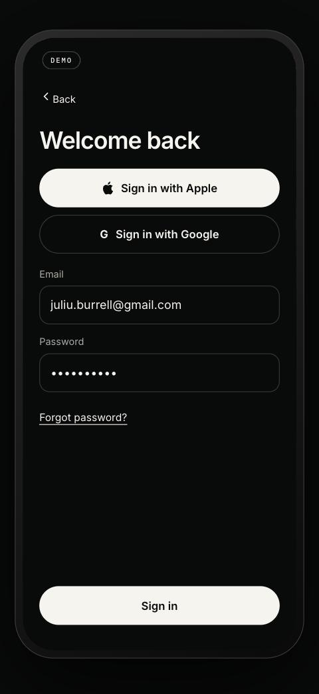

# Sign in — parity with the demo

Demo: 

No rebuilt image: the sign-in screen talks to the sign-in service directly, so it cannot be rendered in the browser harness. It needs a look on a device.

| Element | Demo | Rebuilt | Match |
|---|---|---|---|
| "Welcome back", 32pt, top-aligned | Yes | Yes | ✔ |
| "Sign in with Apple" (warm white) | Yes | **Not shown**: Apple sign-in is not built (spec lists it as an open question) | ✘ feature |
| "G Sign in with Google" (outlined pill) | Yes | Yes | ✔ |
| Email and Password: small sentence-case labels, 52pt fields, 14pt radius | Yes | Yes | ✔ |
| "Forgot password?" underlined, left | Yes | Yes | ✔ |
| "Sign in" warm-white pill at the foot | Yes | Yes | ✔ |
| "Back" to the opening promise screen | Yes | **Not shown**: the app has no promise screen yet | ✘ feature |
| Eyebrow, subtitle, "or" divider, uppercase labels | Not in the demo | Removed | ✔ |
| "Create an account" link | On the demo's promise screen | **Kept** as quiet text under Sign in: it is the only way to sign up until the promise screen exists | ◐ functional |
| Legal line (Terms, Privacy, Health disclaimer) | On the demo's create-account step | **Kept** on sign-in: a compliance requirement | ◐ legal |
